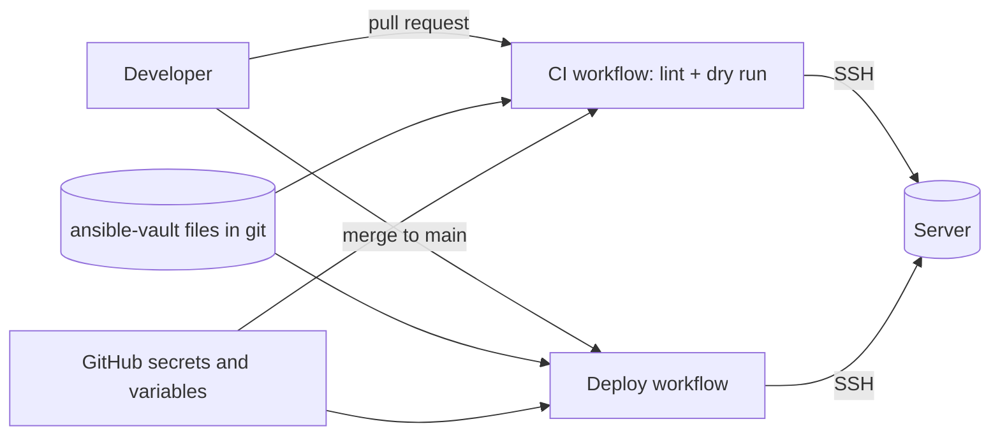

# mm-ansible

Ansible code that builds and maintains the server: MicroK8s with its add-ons, ArgoCD, PostgreSQL and Redis.
It runs in **GitHub Actions**, which connects to the server over **SSH**. Secrets are stored with **ansible-vault**.



## Contents

1. [Repository layout](#repository-layout)
2. [One-time setup](#one-time-setup)
3. [Ansible Vault](#ansible-vault)
4. [Day-to-day](#day-to-day)
5. [PostgreSQL users and roles](#postgresql-users-and-roles)
6. [Redis](#redis)
7. [Other roles](#other-roles)
8. [Troubleshooting](#troubleshooting)

## Repository layout

| Path | Purpose |
|---|---|
| `ansible.cfg` | Defaults: inventory, roles path, vault file, SSH pipelining |
| `requirements.txt` / `requirements.yml` | Pinned Python tools and Ansible collections |
| `inventories/production/hosts.ini` | Inventory. The address comes from `ANSIBLE_HOST` (not stored in git) |
| `inventories/production/group_vars/all/*.yml` | Variables. `*_vault.yml` files are encrypted |
| `playbooks/site.yml` | Everything: preflight, common, cluster, database, cache |
| `playbooks/{cluster,database,cache,common}.yml` | One part each, imported by `site.yml` |
| `roles/` | `microk8s`, `argocd`, `reloader`, `application-pvc`, `postgres`, `redis`, `vault`, `common`, `backup` |
| `.github/workflows/ci.yml` | Pull requests: lint, syntax check, dry run with diff |
| `.github/workflows/deploy.yml` | Push to `main` or manual run: deploy |
| `huponx/actions` `ansible-setup` | Shared setup action (lives in the `actions` repo, used as `@v1`): Python, collections, SSH, vault file |
| `Makefile` | Short commands, see `make help` |

Tags: `microk8s`, `argocd`, `reloader`, `pvc`, `vault`, `postgres`, `postgres_users`, `redis`, `common`, `backup`
(plus group tags `cluster`, `database`, `cache`).

## One-time setup

Do these steps once, in this order.

### 1. Server

Log in as a user with sudo and create a dedicated user for Ansible (named `ansible` here):

```bash
sudo adduser --disabled-password --gecos "" ansible
sudo install -d -m 700 -o ansible -g ansible /home/ansible/.ssh

# Passwordless sudo for this user (Ansible runs with become: true)
echo 'ansible ALL=(ALL) NOPASSWD:ALL' | sudo tee /etc/sudoers.d/ansible
sudo chmod 440 /etc/sudoers.d/ansible
sudo visudo -cf /etc/sudoers.d/ansible
```

Allow SSH key login only (recommended): in `/etc/ssh/sshd_config.d/10-hardening.conf` set
`PasswordAuthentication no` and `PermitRootLogin no`, then `sudo systemctl reload ssh`.
Do this only after you have verified key login in step 3.

Network: the SSH port must be reachable from GitHub-hosted runners (public internet), or use a self-hosted runner.
Make sure the DNS name of the server resolves (and the extra names you use, for example the ArgoCD host).
`metallb_ip_range` in `inventories/production/group_vars/all/microk8s.yml` must be free addresses in your LAN.

### 2. Your machine

```bash
git clone <this repository> && cd mm-ansible
python3 -m venv .venv && . .venv/bin/activate
make deps                       # pip install -r requirements.txt + ansible-galaxy collection install

cp .env.example .env            # then edit: ANSIBLE_HOST, ANSIBLE_USER, ANSIBLE_SSH_PORT
printf '%s' 'a-long-random-passphrase' > .vault_pass && chmod 600 .vault_pass
```

`.env` and `.vault_pass` are gitignored. Keep the passphrase in a password manager: it is also needed in GitHub (step 4).

### 3. SSH key for CI

Create a key pair used **only** by GitHub Actions:

```bash
ssh-keygen -t ed25519 -f mm-ansible-deploy-key -N "" -C "mm-ansible-deploy"
```

This creates `mm-ansible-deploy-key` (private) and `mm-ansible-deploy-key.pub` (public) in the current directory on your machine.
The `ansible` user has no password (step 1), so `ssh-copy-id` cannot log in as it. Install the public key
with your own admin account instead:

```bash
scp mm-ansible-deploy-key.pub ADMIN_USER@YOUR_SERVER:/tmp/mm-ansible-deploy-key.pub
ssh ADMIN_USER@YOUR_SERVER
  sudo install -d -m 700 -o ansible -g ansible /home/ansible/.ssh
  sudo sh -c 'cat /tmp/mm-ansible-deploy-key.pub >> /home/ansible/.ssh/authorized_keys'
  sudo chown ansible:ansible /home/ansible/.ssh/authorized_keys
  sudo chmod 600 /home/ansible/.ssh/authorized_keys
  rm /tmp/mm-ansible-deploy-key.pub
```

Only the public key goes to the server (appended to `/home/ansible/.ssh/authorized_keys`). Test it:

```bash
ssh -i mm-ansible-deploy-key ansible@YOUR_SERVER 'sudo -n true && echo OK'
```

Pin the server host key (do this from a network you trust, and compare the fingerprint with the server):

```bash
ssh-keyscan -t ed25519 -p 22 YOUR_SERVER > mm-ansible-known-hosts
ssh-keygen -lf mm-ansible-known-hosts                      # compare with: ssh-keygen -lf /etc/ssh/ssh_host_ed25519_key.pub (on the server)
```

`mm-ansible-deploy-key`, `mm-ansible-deploy-key.pub` are gitignored. Delete the local private key after you store it in GitHub (step 4).

### 4. GitHub repository settings

Settings, Secrets and variables, Actions:

| Kind | Name | Value |
|---|---|---|
| Secret | `ANSIBLE_SSH_PRIVATE_KEY` | content of `mm-ansible-deploy-key` |
| Secret | `ANSIBLE_KNOWN_HOSTS` | content of `mm-ansible-known-hosts` |
| Secret | `ANSIBLE_VAULT_PASS` | the passphrase in `.vault_pass` |
| Variable | `ANSIBLE_HOST` | server address, for example `server.example.com` |
| Variable | `ANSIBLE_USER` | `ansible` |
| Variable | `ANSIBLE_SSH_PORT` | `22` (optional, default 22) |

Or with the [GitHub CLI](https://cli.github.com/) (`gh auth login` first; run inside the repository or add `-R OWNER/REPO` to every command):

```bash
# Secrets (values are read from files, never typed on the command line)
gh secret set ANSIBLE_SSH_PRIVATE_KEY < mm-ansible-deploy-key
gh secret set ANSIBLE_KNOWN_HOSTS     < mm-ansible-known-hosts
gh secret set ANSIBLE_VAULT_PASS      < .vault_pass

# Variables
gh variable set ANSIBLE_HOST     --body "server.example.com"
gh variable set ANSIBLE_USER     --body "ansible"
gh variable set ANSIBLE_SSH_PORT --body "22"

# Check what is set (secret values are never shown)
gh secret list
gh variable list
```

Use the repository-level secrets above (the CI dry run job and the deploy job both read them).
`.vault_pass` must contain the passphrase without a trailing newline problem: `printf '%s' '...' > .vault_pass` (as in step 2) is correct.

Then:

- **Settings, Environments, New environment** `production`: add **Required reviewers** so a deploy needs an approval.
- **Settings, Branches, protect** `main`: require a pull request and the status check **CI / lint and syntax**
(and **CI / dry run against the server** if you want the dry run to gate merges).

The same with `gh api` (replace `OWNER/REPO`, and `REVIEWER` with a GitHub username):

```bash
REPO=huponx/mm-ansible

# Environment `production` with a required reviewer
REVIEWER_ID=$(gh api users/REVIEWER --jq .id)
gh api -X PUT "repos/$REPO/environments/production" \
  --input - <<EOF
{ "reviewers": [ { "type": "User", "id": $REVIEWER_ID } ] }
EOF

# Merge settings
gh api -X PATCH "repos/$REPO" -F allow_squash_merge=true -F allow_merge_commit=false \
  -F allow_rebase_merge=false -F delete_branch_on_merge=true \
  -f squash_merge_commit_title=PR_TITLE -f squash_merge_commit_message=PR_BODY

# Ruleset for `main`: PR required (squash only, 0 approvals so you can merge your own PR),
# required check `lint and syntax`, no force push, no deletion
cat > main-ruleset.json <<'JSON'
{
  "name": "main",
  "target": "branch",
  "enforcement": "active",
  "conditions": { "ref_name": { "include": ["~DEFAULT_BRANCH"], "exclude": [] } },
  "bypass_actors": [
    { "actor_id": 5, "actor_type": "RepositoryRole", "bypass_mode": "pull_request" }
  ],
  "rules": [
    { "type": "deletion" },
    { "type": "non_fast_forward" },
    {
      "type": "pull_request",
      "parameters": {
        "required_approving_review_count": 0,
        "dismiss_stale_reviews_on_push": false,
        "require_code_owner_review": false,
        "require_last_push_approval": false,
        "required_review_thread_resolution": false,
        "allowed_merge_methods": ["squash"]
      }
    },
    {
      "type": "required_status_checks",
      "parameters": {
        "strict_required_status_checks_policy": true,
        "required_status_checks": [ { "context": "lint and syntax" } ]
      }
    }
  ]
}
JSON
gh api "repos/$REPO/rulesets" --method POST --input main-ruleset.json
rm main-ruleset.json       # the file is only an input, do not commit it

# Check
gh api "repos/$REPO/environments/production" --jq '.protection_rules'
gh api "repos/$REPO/rulesets" --jq '.[] | {id, name, enforcement}'
```

Notes:

- Rulesets and required reviewers on private repositories need a paid GitHub plan (Pro, Team or Enterprise); public repositories have them for free.
- This is the same ruleset as `charts` and `mm-deploy` (PR required, squash only, strict required checks, no force push or deletion, repository admins bypass through a pull request). To change it later: `gh api repos/$REPO/rulesets/<id> --method PUT --input main-ruleset.json`.
- The status check name is the job name (`lint and syntax`). A check only appears in the list after it has run once, so open one pull request first.
- To run the deploy workflow by hand: `gh workflow run Deploy -f tags=postgres_users -f check_only=true`, then `gh run watch`.

### 5. Encrypt the vault files and make the first deploy

```bash
# edit the real secrets, then encrypt (skip files that are already encrypted: they start with $ANSIBLE_VAULT)
ansible-vault edit inventories/production/group_vars/all/postgres_vault.yml
ansible-vault edit inventories/production/group_vars/all/redis_vault.yml

make syntax
make check                      # dry run against the server, changes nothing
```

Run **Actions, Deploy, Run workflow** with `check_only` ticked, read the diff in the log, then run it again without it.
After the first run verify on the server:

```bash
pg_isready                      # accepting connections
redis-cli -a "$REDIS_PASSWORD" ping    # PONG
microk8s status --wait-ready
```

## Ansible Vault

Which files are encrypted:

| File | Contains |
|---|---|
| `inventories/production/group_vars/all/postgres_vault.yml` | `vault_postgres_user_passwords` (one entry per user) |
| `inventories/production/group_vars/all/redis_vault.yml` | `vault_redis_password` |
| `inventories/production/group_vars/all/argocd_vault.yml` | `vault_argocd_user_passwords` (one entry per ArgoCD user, only when `argocd_users` is used) |

Plain files only reference names, for example `postgres.yml` lists users, never passwords.
Rule: anything called `*_vault.yml` is encrypted before commit.
Check with `head -1 <file>`: it must print `$ANSIBLE_VAULT;1.1;AES256`.

```bash
ansible-vault create inventories/production/group_vars/all/new_vault.yml   # new encrypted file
ansible-vault encrypt <file>                                               # encrypt an existing plain file
ansible-vault edit <file>                                                  # decrypt, edit, re-encrypt
ansible-vault view <file>                                                  # read only
ansible-vault rekey <file>                                                 # change passphrase (see below)
make vault-edit F=postgres_vault.yml                                       # shortcut
```

The passphrase is read from `.vault_pass` locally and from `ANSIBLE_VAULT_PASS` in CI.

**Rotate the passphrase**

1. Write the new passphrase to `.vault_pass.new`.
2. `ansible-vault rekey --new-vault-password-file .vault_pass.new inventories/production/group_vars/all/*_vault.yml`
3. `mv .vault_pass.new .vault_pass`, update the GitHub secret `ANSIBLE_VAULT_PASS`, and commit the re-encrypted files in the same pull request.

   Do the secret update and the merge back to back: a deploy between them fails to decrypt.

**Never commit**: `.vault_pass`, `.env`, `mm-ansible-deploy-key`, decrypted vault files. If one is committed, treat the secret as leaked, rotate it and rewrite history.

**Lost passphrase**: encrypted files cannot be recovered. Recreate them with new secrets and change the matching passwords on the server
(set `rotate_password: true` for PostgreSQL users, run the redis role for the Redis password).

## Day-to-day

```bash
make check                          # dry run with diff, everything
make check TAGS=redis               # dry run, one component
make deploy TAGS=postgres_users     # apply one component
make deploy LIMIT=localserver       # one host
make lint                           # yamllint + ansible-lint
```

| In CI | Equivalent |
|---|---|
| Pull request | `make lint syntax` and `make check` (read-only) |
| Merge to `main` | deploy workflow, only for what changed (below), after approval of the `production` environment |
| Manual run | **Actions, Deploy, Run workflow**: optional `tags`, `limit`, `check_only` |

**What a merge to `main` deploys.** The `plan` job of the deploy workflow reads the changed files
([`.github/scripts/deploy-tags.sh`](.github/scripts/deploy-tags.sh)) and picks the tags:

| Changed files | Deploys |
|---|---|
| `roles/<role>/**` or `group_vars/all/<role>*.yml` of `microk8s`, `argocd`, `reloader`, `application-pvc` (tag `pvc`), `vault`, `postgres`, `redis`, `common`, `backup` | only the tags of those components, for example `argocd` |
| docs (`*.md`), `.github/**`, `Makefile`, lint configs, `requirements.txt`, `.env.example` | nothing: the deploy job and its approval are skipped |
| anything else (`playbooks/`, `inventories/**/hosts.ini`, `ansible.cfg`, `requirements.yml`, a new role) | everything |

So bumping `argocd_version` in `argocd.yml` deploys only `argocd`. **Actions, Deploy, Run workflow** always uses its own `tags` input (empty = everything).
A new component must be added to the script, otherwise a change to it falls into "everything".

A second run must report `changed=0`. If it does not, something is not idempotent: open an issue or fix the task.

**Roll back**: revert the pull request and merge it, the deploy applies the previous state.
Packages and database content are not reverted by Ansible: restore from backups when needed (see the `backup` role below).

**Upgrade ArgoCD** by changing `argocd_version` in `inventories/production/group_vars/all/argocd.yml` (pinned, default in the role).

## PostgreSQL users and roles

`inventories/production/group_vars/all/postgres.yml` is the source of truth; every run makes the server match it.
Passwords are in `postgres_vault.yml` under `vault_postgres_user_passwords`, keyed by user name.

### Add a user

1. Add the password:
   ```bash
     ansible-vault edit inventories/production/group_vars/all/postgres_vault.yml
   ```
2. Declare the user in `postgres.yml`:
   ```yaml
     postgres_users:
       - name: reports-ro
         databases:
           - name: data
             priv: SELECT                   # ALL | SELECT | INSERT | UPDATE | DELETE (comma separated)
   ```
3. Apply: `make deploy TAGS=postgres_users` (or merge to `main`).

What it does: creates the login, creates the database if it does not exist (owner = first user that references it, or `postgres_databases`),
grants `CONNECT` and `USAGE`, grants the privileges on existing tables and sequences, and sets **default privileges** so tables created later by migrations
are usable too. Privileges that are no longer wanted are revoked, so changing `ALL` to `SELECT` really removes write access.

### Use group roles

Grant privileges once to a group role and add users as members:

```yaml
postgres_roles:
  - name: data_readonly
    databases:
      - { name: data, priv: SELECT }

postgres_users:
  - name: reports-ro
    roles: [data_readonly]
    databases: []
```

Remove a membership with `revoke_roles: [data_readonly]`.

### Change privileges, limits or the password

- Privileges: change `priv` and apply.
- Limits: `attrs: { connection_limit: 20, valid_until: "2027-01-01", role_attr_flags: "CREATEDB" }`.
- Password: edit the value in `postgres_vault.yml`, set `rotate_password: true` on the user, apply, then remove the flag.
Without the flag, an existing user's password is never overwritten. (`postgres_rotate_passwords: true` rotates every user.)
If a vault password does not match the server, the run prints a warning ("Login check failed").

### Remove a user

```yaml
postgres_users:
  - name: reports-ro
    state: absent
```

Apply. The user's objects are reassigned to `postgres`, its privileges are dropped, then the role is dropped. The database is **not** dropped.
You can delete the vault entry afterwards.

### Remove a database (data loss)

```yaml
postgres_databases:
  - name: old_db
    state: absent
```

This only prints a notice unless you also set `postgres_allow_drop_databases: true` for that run.

### Server roles that are not in the file

`postgres_prune_unmanaged` (default `report`) lists roles on the server that are not defined here.
`delete` drops them (after reassigning their objects), `off` ignores them. `postgres` and `pg_*` roles are always protected
(`postgres_protected_roles`).

### Verify

```bash
sudo -u postgres psql -c '\du'                 # roles and members
sudo -u postgres psql -d data -c '\dp'        # table privileges
sudo -u postgres psql -d data -c '\ddp'       # default privileges
PGPASSWORD=... psql -h SERVER -U reports-ro -d data -c 'select 1'
```

`make check TAGS=postgres_users` shows the planned changes first.

PostgreSQL access from outside the host comes from `postgres_allowed_cidrs` (default `10.1.0.0/16`) with `postgres_auth_method: scram-sha-256`.
If a password was stored as an md5 hash before, set `postgres_auth_method: md5` or rotate that password.

### ArgoCD users

The built-in `admin` account is not managed by Ansible (its first password is in the secret
`argocd-initial-admin-secret`). Extra local accounts are listed in
`inventories/production/group_vars/all/argocd.yml`:

```yaml
argocd_users:
  - name: hung
    role: admin          # admin | readonly | a role you define in argocd_rbac_extra_policy
    apikey: false        # true lets the account create API tokens
  - name: old-user
    state: absent        # removes the account and its password
```

Roles you can give a user (the `role` field):

| Role | Can do |
|---|---|
| `admin` | everything: manage applications, projects, repositories, clusters, settings |
| `readonly` | view applications and projects, no changes (also the default for accounts without a role) |
| your own | any role defined in `argocd_rbac_extra_policy`, for example `deployer` below |

```yaml
argocd_rbac_extra_policy: |
  p, role:deployer, applications, get, */*, allow
  p, role:deployer, applications, sync, */*, allow
```

With that, `role: deployer` on a user lets them view and sync applications but not edit or delete them.
Policy syntax: [ArgoCD RBAC](https://argo-cd.readthedocs.io/en/stable/operator-manual/rbac/).

Passwords go in `argocd_vault.yml` (create it, then encrypt):

```bash
cat > inventories/production/group_vars/all/argocd_vault.yml <<'EOF'
vault_argocd_user_passwords:
  hung: "a-long-random-password"
EOF
make vault-encrypt F=argocd_vault.yml
make deploy TAGS=argocd
```

- ArgoCD cannot switch off "change my password" in its UI or CLI. Ansible is the source of truth instead: with `argocd_enforce_passwords: true` (default) every run compares the stored hash with the vault password and puts the vault one back when they differ. A password changed in the UI therefore lasts until the next deploy, and that user is signed out when it is reverted. Set `argocd_enforce_passwords: false` to only set the password of accounts that have none.
- To change a password on purpose, edit the vault file and deploy (with enforcement on, nothing else is needed; with it off, also set `rotate_password: true` on the user once). A deploy that changes nothing does not touch the passwords or sign anyone out.
- `policy.csv` of `argocd-rbac-cm` is managed from `argocd_users` (`g, <user>, role:<role>` lines) plus `argocd_rbac_extra_policy`; manual edits to it are overwritten while `argocd_users` is not empty. `argocd_rbac_default_policy` (default `role:readonly`) applies to everyone else.
- The `password_hash('bcrypt')` filter needs `passlib` and `bcrypt` on the machine that runs Ansible (in `requirements.txt`, so `make deps` installs them).

## Redis

| Variable | Default | Description |
|---|---|---|
| `redis_port` | `6379` | Port |
| `redis_bind` | `0.0.0.0` | Interfaces. Prefer the private address of the server |
| `redis_require_password` | `true` | Sets `requirepass`; needs `vault_redis_password` |
| `redis_upgrade` | `false` | Upgrade the package on every run |
| `redis_maxmemory`, `redis_maxmemory_policy` | empty, `noeviction` | Optional memory limit |

Password: `ansible-vault edit inventories/production/group_vars/all/redis_vault.yml`, set `vault_redis_password`, then `make deploy TAGS=redis`.
The role checks `redis-cli ping` at the end.

## Other roles

| Role | Purpose | Main variables |
|---|---|---|
| `microk8s` | Install MicroK8s, enable the add-ons in `microk8s_addons`, cert-manager issuer | `microk8s_version`, `metallb_ip_range`, `microk8s_addons`, `acme_email`, `cluster_issuer_name` |
| `argocd` | Install ArgoCD (pinned manifest), its ingress and optional local users (`argocd_users`) | `argocd_version`, `argocd_ingress_host`, `argocd_external_url` |
| `reloader` | Stakater Reloader (Helm) | `reloader_chart_version` |
| `application-pvc` | PersistentVolumeClaim for applications | `pvc_name`, `pvc_namespace`, `pvc_storage`, `pvc_storage_class` |
| `vault` | HashiCorp Vault and External Secrets Operator. Off unless `vault_enabled: true` | `vault_ingress_host`, `vault_dev_mode`, `eso_chart_version` |
| `common` | Optional: unattended upgrades, fail2ban, UFW. Off unless `common_enabled: true` | `common_ufw_enabled`, `common_ufw_rules` |
| `backup` | Optional: daily PostgreSQL dumps and Redis RDB copy via a systemd timer. Off unless `backup_enabled: true` | `backup_dir`, `backup_keep_days`, `backup_schedule` |

Before enabling the firewall (`common_ufw_enabled: true`) make sure the SSH port and the cluster ports you use are in `common_ufw_rules`.
Backups are stored on the same server: copy `backup_dir` somewhere else for real disaster recovery.
Restore a database with `pg_restore -d data --clean /var/backups/mm/postgres-data-<stamp>.dump`.

## Troubleshooting

| Symptom | Cause and fix |
|---|---|
| `Host key verification failed` | `ANSIBLE_KNOWN_HOSTS` is wrong or the server was rebuilt. Re-scan from a trusted network, compare the fingerprint, update the secret. |
| `Permission denied (publickey)` | The CI public key is not in `/home/ansible/.ssh/authorized_keys`, or `ANSIBLE_USER` is wrong. Test with `ssh -i mm-ansible-deploy-key ansible@HOST`. |
| `Decryption failed` / `vault password file was not found` | Wrong `ANSIBLE_VAULT_PASS` or `.vault_pass`. Check with `ansible-vault view <file>`. |
| `sudo: a password is required` | The sudoers rule is missing. Redo step 1. The preflight play reports this first. |
| `Could not get lock /var/lib/dpkg/lock` | `unattended-upgrades` is running. Wait and re-run. |
| `Missing ANSIBLE_HOST variable ...` in the workflow | Variable or secret not set, or set on another environment. See step 4. |
| `Invalid PostgreSQL configuration` | The assert lists the rules: names with letters, digits, `_`, `-`; no protected or `pg_*` role; every present user has a vault password; owners are managed users. |
| `kubectl`/`microk8s` permission errors | The user must be in the `microk8s` group (the role adds it; log in again). |
| Dry run shows tasks as changed that are not | `--check` cannot predict commands that depend on earlier changes. Compare with a real second run (`changed=0`). |
